# AlgoMotion

**Algorithms aren't magic. Watch them work.**

AlgoMotion is an interactive data-structures-and-algorithms lab, a coding-interview workspace and an honest AI problem solver. Every animation is replayed from a recorded execution trace, so what you see is exactly what the algorithm did, step by step. A crew of original cartoon characters reacts to those steps, but never drives them.

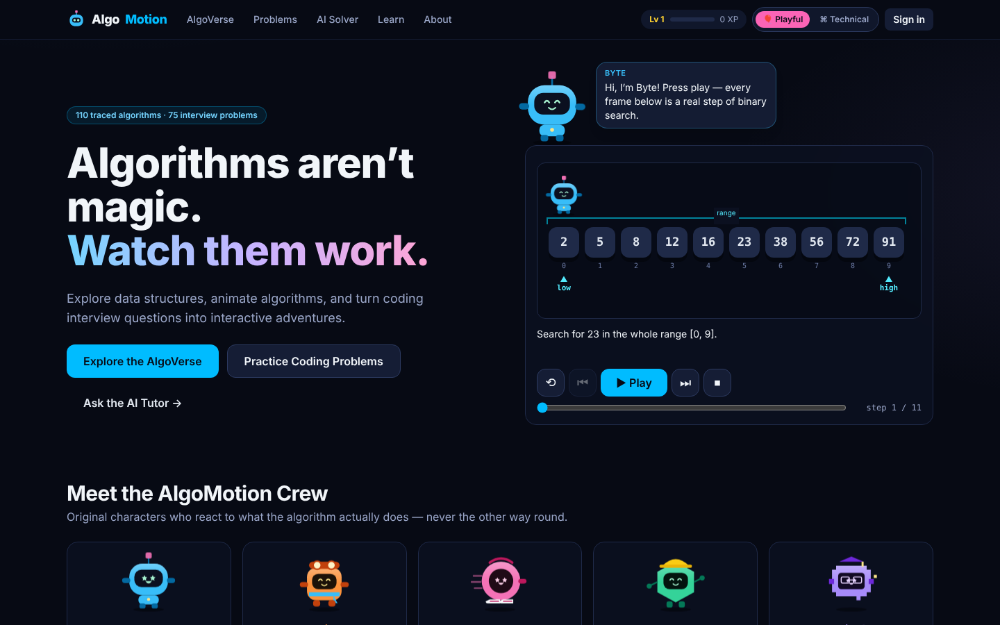

---

## Contents

1. [Why](#why) · 2. [Features](#features) · 3. [Screenshots](#screenshots) · 4. [Architecture](#architecture) · 5. [Tech stack](#tech-stack) · 6. [Services](#microservice-responsibilities) · 7. [Database](#database) · 8. [Kafka event flow](#kafka-event-flow) · 9. [Trace engine](#trace-engine) · 10. [Characters](#character-animation-architecture) · 11. [AI workflow](#ai-solution-workflow) · 12. [Secure execution](#secure-code-execution) · 13. [API](#api) · 14. [Getting started](#getting-started) · 15. [Testing](#testing) · 16. [Deployment](#deployment) · 17. [Known limitations](#known-limitations) · 18. [Roadmap](#roadmap) · 19. [License](#license--attributions)

## Why

Most algorithm visualizers are either beautiful but loosely tied to the real algorithm, or accurate but dry. AlgoMotion tries to be both:

- **Accurate.** Algorithms are real implementations that emit a versioned trace (schema v1.0). The renderer only displays trace snapshots. It never runs algorithm logic itself.
- **Playful.** Five original characters and themed "worlds" make exploration fun, and a **Technical mode** turns the same trace into clean diagrams with indices, pointers and pseudocode.
- **Honest.** AI output is labelled *Generated → Tests passed / Tests failed / Manual review*. Nothing is called verified until the sandboxed execution service has actually run it.

## Features

| Area | What's there |
|---|---|
| **DSA Lab** | **110 traced algorithms** in 14 categories: arrays (12 ops), searching (7), sorting (8), linked lists (14 ops: singly/doubly/circular), stacks (7), queues (linear/circular/deque/priority), hash tables (chaining + linear probing, resize/rehash, tombstones), trees (traversals, BST ops incl. all 3 delete cases, AVL insert/delete with LL/RR/LR/RL), heaps (tree + array view), tries, graphs (13 incl. BFS, DFS, Dijkstra, Bellman-Ford, Floyd-Warshall, Kahn, cycle detection, components, Kruskal, Prim, Union-Find, graph editor with adjacency matrix), recursion & backtracking, DP, interview patterns |
| **Playback** | Play / pause / resume / step / back / restart / reset, draggable timeline, 0.5–2× speed, keyboard control, pseudocode line highlighting, variables, complexity + per-input operation counts, execution log, input editing, seeded random inputs, side-by-side sorting race |
| **AlgoVerse** | World selection (Array Adventure, Linked List City, Stack Tower, Queue Express, Tree Forest, Graph Galaxy, Sorting Speedway, Recursion Mountain, DP Lab, …) with draggable graph vertices |
| **Modes** | Persistent Playful / Technical toggle over the *same* trace data |
| **Mini-challenges** | 8 challenges (find the number, repair the linked list, stack the blocks, next BFS node, complete the DP table, will they swap?, next inorder node, bracket detective). Answers are computed from the trace, never from AI |
| **Problem library** | **75 original problems** across 26 topics. Each has brute-force and/or optimized Java solutions, pseudocode, complexity, hints, edge cases and tests. **All 137 reference solutions are compiled and run against their tests** (`content/src/build.py --verify`). 48 problems link to a visualization |
| **Workspace** | Monaco Java editor (bundled locally), asynchronous sandboxed test runs with per-test expected/actual output, brute-vs-optimized tabs and visualizations |
| **AI solver** | Paste text or upload .txt / .md / .pdf / image (OCR). You review the extracted text before generating. A provider-independent LLM layer (OpenAI-compatible, Anthropic) or a deterministic **catalog fallback** when no key is configured. Structured-output validation; generated code is tested in the sandbox |
| **Gamification** | Optional XP, levels, 9 badges, learning paths. XP is idempotent per achievement (no farming) and there are no streak mechanics |
| **Accounts** | JWT access token (in memory) + rotating httpOnly refresh cookie with reuse detection, bookmarks, saved sessions/history, server-side progress & achievements, owner-only data access |

## Screenshots

All screenshots were captured from the running application (frontend + all six services on PostgreSQL, Redis and Kafka).

| | |
|---|---|
| 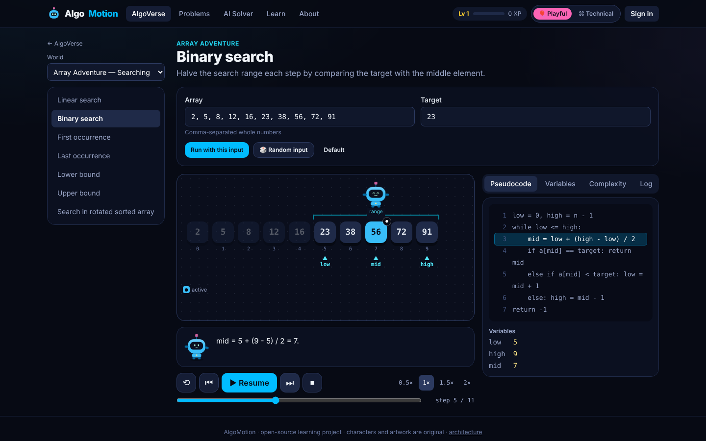 Binary search in Playful mode — Byte stands on `mid`; low/mid/high pointers, live variables | 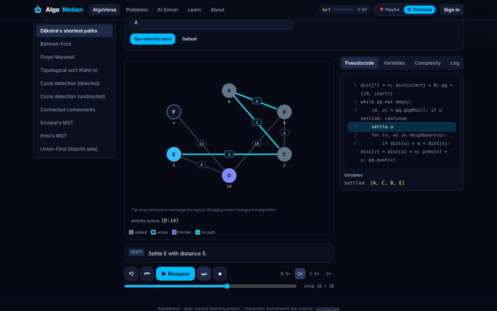 Dijkstra in Technical mode — distances, settled set, priority queue |
| 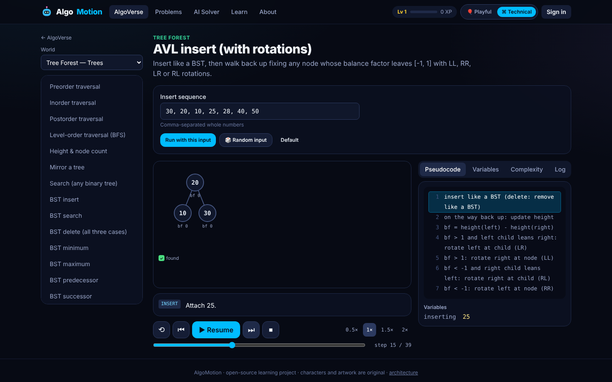 AVL insert with balance factors and rotations | 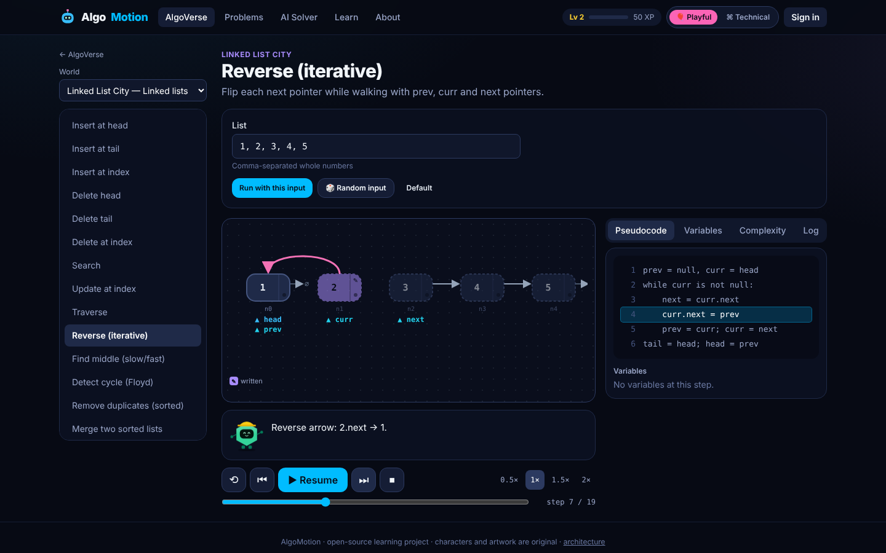 Reversing a linked list: prev/curr/next pointers, rewired arrows |
| 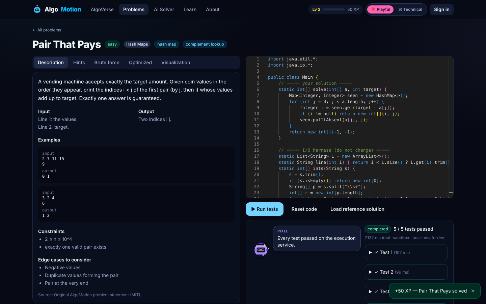 Problem workspace: Java editor + sandbox results (5/5 tests) | 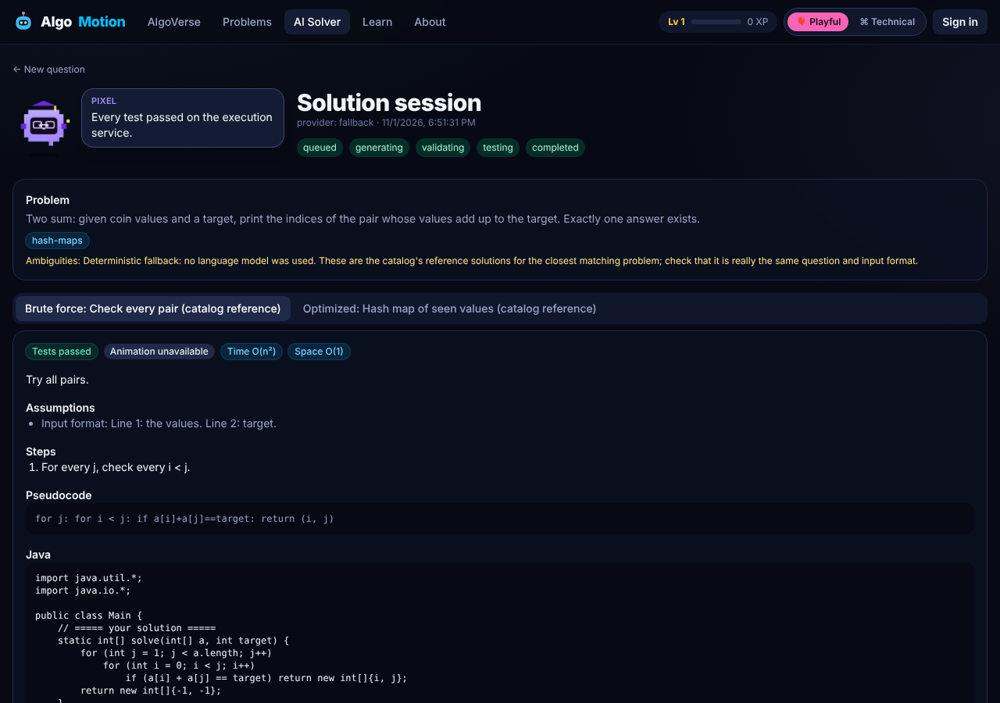 AI solver session with an honest status ladder and verdicts |
| 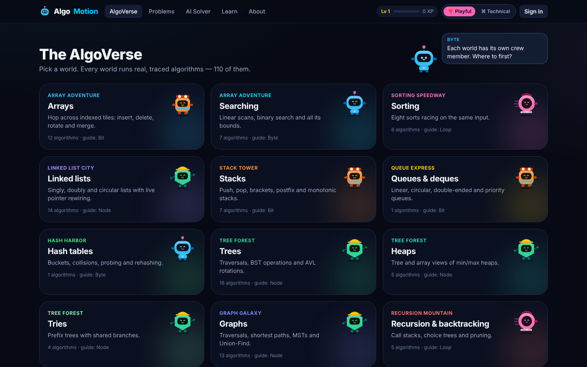 The AlgoVerse world map | 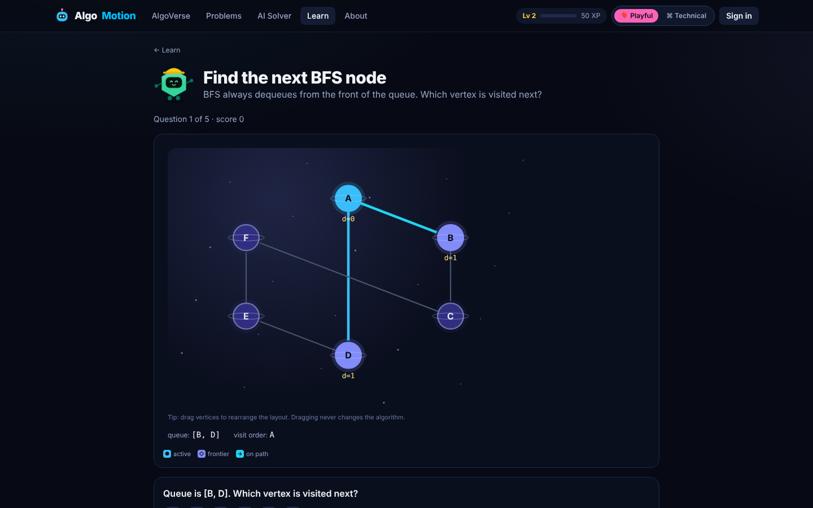 "Find the next BFS node" mini-challenge |

## Architecture

```mermaid
flowchart LR
    subgraph Browser
        UI[React + TS SPA<br/>trace player & renderers]
    end
    UI -- /api/v1 --> GW[API Gateway<br/>Spring Cloud Gateway]
    GW -- rate limits --> R[(Redis)]
    GW --> US[user-progress-service]
    GW --> VS[algorithm-visualization-service]
    GW --> CS[problem-catalog-service]
    GW --> AS[ai-solution-service]
    GW --> ES[code-execution-service]
    US -- internal API --> CS
    ES -- internal API: tests --> CS
    AS -- internal API: submit / results --> ES
    AS -- internal API: fallback match --> CS
    AS -- HTTPS --> LLM[(LLM provider<br/>optional)]
    AS <-- Kafka --> K[(Kafka)]
    ES <-- Kafka --> K
    US & CS & AS & ES --> PG[(PostgreSQL<br/>schema per service)]
    ES -- docker run --network none --> SB[[Throwaway sandbox container]]
```

The frontend also runs fully offline: the algorithm engine is in the browser, and the problem catalog is bundled as a fallback (the UI shows a banner when the backend is unreachable). The backend adds accounts, persistence, code execution and the AI solver.

## Tech stack

**Frontend:** React 19, TypeScript (strict), Vite, React Router, Tailwind CSS v4, Motion (Framer Motion), SVG/CSS renderers, Monaco Editor (bundled locally), TanStack Query, Zustand, Vitest, React Testing Library, Playwright.

**Backend:** Java 21, Spring Boot 3.5, Maven multi-module, Spring Web/Validation/Data JPA/Security (OAuth2 resource server, HS256 JWT), Spring Cloud Gateway (WebFlux), PostgreSQL 16 + Flyway, Redis (gateway rate limiting), Apache Kafka (transactional outbox, idempotent consumers, DLT), Actuator + Micrometer/Prometheus, springdoc-openapi, PDFBox, JUnit 5, Mockito, Testcontainers, Spring Kafka embedded broker.

**Infrastructure:** Docker, Docker Compose, GitHub Actions.

## Microservice responsibilities

| Service | Port | Owns | Notes |
|---|---|---|---|
| `api-gateway` | 8080 | — | Routing, correlation IDs, Redis token-bucket rate limiting (tight limits on auth/execution/AI), CORS, security headers, strips forged `X-Internal-Token`, `/api/v1/status` |
| `user-progress-service` | 8081 | `users` schema | Register/login/refresh/logout, preferences, bookmarks, idempotent XP ledger, achievements, saved sessions with ownership checks |
| `algorithm-visualization-service` | 8082 | — (stateless) | Java trace engine for search/sort/BFS/Dijkstra; trace validation; **conformance-tested against the TypeScript engine** |
| `problem-catalog-service` | 8083 | `catalog` schema | Seeds `content/problems.json` idempotently (content hash), search/filter/pagination, sample tests publicly, all tests via internal API |
| `ai-solution-service` | 8085 | `solutions` schema | Upload extraction, provider layer, response validation, async jobs, verdicts from execution results |
| `code-execution-service` | 8086 | `execution` schema | Async job queue, Docker sandbox runner, per-test results, timeouts, output limits, metrics |

Services never share tables; cross-service data goes through `/internal/**` endpoints protected by a shared internal token. These endpoints are never routed by the gateway.

## Database

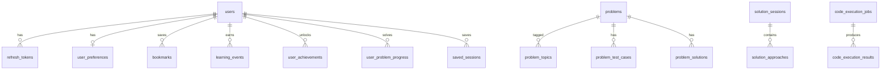

Each service has its own schema and Flyway history (`users`, `catalog`, `solutions`, `execution`). `bookmarks.problem_slug` and `solution_approaches.execution_id` are references across service boundaries by design (no cross-schema foreign keys). Traces are **not stored**: saved sessions keep the algorithm + input (≤16 KB, enforced by a CHECK constraint) and the trace is regenerated deterministically. See [docs/database.md](docs/database.md).

## Kafka event flow

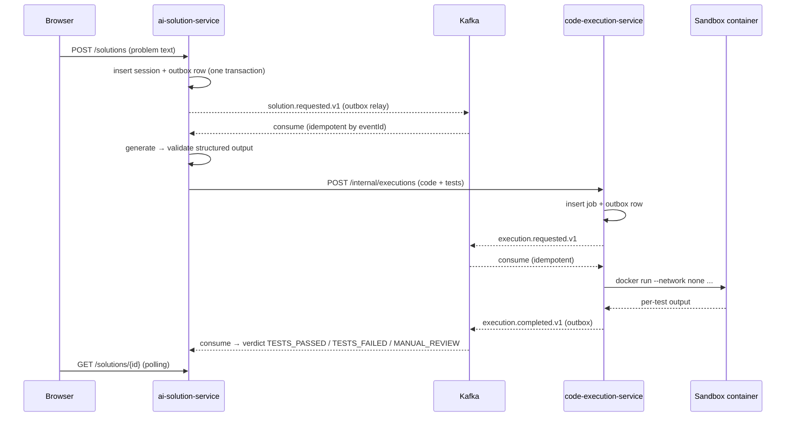

Events carry `eventId`, `schemaVersion` and `correlationId`. Consumers retry 3× with exponential backoff, then route to `<topic>.DLT`. A `MESSAGING_ENABLED=false` mode runs the same workers in-process for single-node development.

## Trace engine

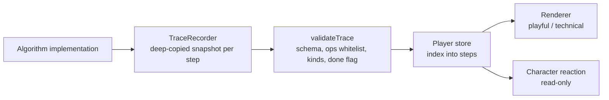

Every step stores the full visual state, so **seek = array index**. There is no replay drift, pausing cannot mutate state, and stale timers are ignored via a generation counter. Animation timing only decides *when* the next snapshot appears. Character reactions are a pure function of the current step. Details: [docs/animation-engine.md](docs/animation-engine.md).

## Character animation architecture

The AlgoMotion Crew are original inline-SVG characters (`frontend/src/components/mascot/Mascot.tsx`): **Byte** (guide robot), **Bit** (explorer), **Loop** (speedster), **Node** (builder) and **Pixel** (AI tutor). Each has 8 moods and 13 animation states (idle, wave, walk, run, jump, think, celebrate, confused, point, hint, error, loading, sleep) in CSS keyframes. `reactions.ts` maps trace operations and confirmed job states to reactions (`COMPARE → thinking`, `FOUND → celebrate`, `TESTS_PASSED` only after the execution service reports success). Reactions freeze during 2× playback or with reduced motion.

## AI solution workflow

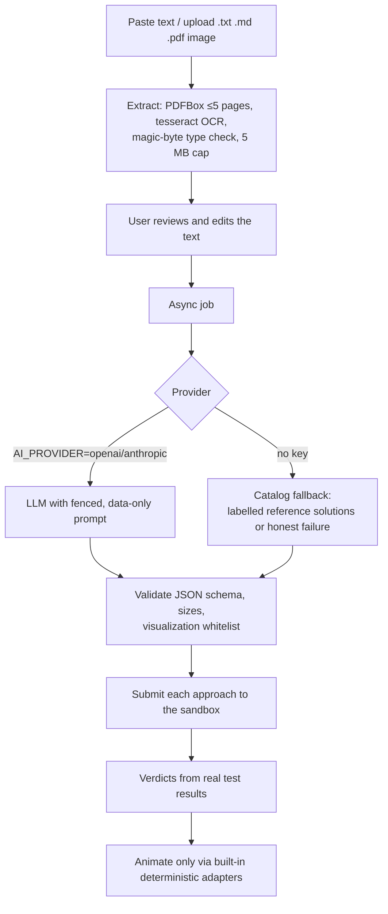

The model can never supply rendering code: `visualization` must name one of the built-in trace adapters, with whitelisted, size-limited input. Otherwise the UI says *animation unavailable*.

## Secure code execution

- User code **never runs in a service JVM**. `DockerSandbox` starts a fresh container per submission with `--network none --read-only --tmpfs /tmp --memory 256m --cpus 1 --pids-limit 128 --cap-drop ALL --security-opt no-new-privileges --user 65534`. Only the source and test inputs are mounted (read-only). There is no Docker socket and there are no secrets in the sandbox.
- Per-test `timeout -s KILL`, an overall container deadline (`docker kill`), and stdout/stderr truncation.
- Source pre-checks (size, `public class Main`, no package), bounded concurrency (semaphore), gateway rate limits, queue/timeout/duration metrics.
- `EXECUTION_SANDBOX=local` is a **development-only** fallback (separate JVM process with heap cap, timeouts and output limits, but **no** filesystem/network isolation). It is labelled `local-unsafe-dev` in every result.

See [docs/security.md](docs/security.md) for the threat model and the remaining risks. The main one: the execution service itself holds the Docker socket.

## API

All public endpoints are under `/api/v1` through the gateway. OpenAPI docs are served by each service at `/swagger-ui.html` (e.g. http://localhost:8083/swagger-ui.html). Summary in [docs/api.md](docs/api.md).

| Area | Endpoints |
|---|---|
| Auth | `POST /auth/register` `POST /auth/login` `POST /auth/refresh` `POST /auth/logout` |
| Algorithms | `GET /algorithms` `GET /algorithms/{slug}` `POST /visualizations` |
| Problems | `GET /problems?q&topic&difficulty&page&size` `GET /problems/topics` `GET /problems/{slug}` |
| AI solver | `POST /solutions` `GET /solutions/{id}` `GET /solutions/{id}/status` `POST /solutions/{id}/validate` `POST /solutions/extract` |
| Execution | `POST /executions` `GET /executions/{id}` `GET /executions/{id}/results` |
| User | `GET /users/me` `GET/PUT /users/me/preferences` `GET /users/me/progress` `POST /users/me/progress/events` `GET /users/me/achievements` `GET/POST /users/me/bookmarks` `DELETE /users/me/bookmarks/{slug}` `GET /users/me/history` `POST /users/me/sessions` `GET/DELETE /users/me/sessions/{id}` |
| Ops | `GET /status`, each service's `/actuator/health`, `/actuator/prometheus` |

Errors always use one envelope: `{status, code, message, details, correlationId, timestamp}`.

## Getting started

### Prerequisites

- Docker with Compose v2 (for the full stack), **or** Java 21 + Maven 3.9, Node 22, PostgreSQL 16, Redis 7, Kafka 3.9 for a manual setup
- Python 3 (only to rebuild the problem catalog)

### Option A — Docker Compose (full stack)

```bash
cp .env.example .env                  # then set JWT_SECRET, INTERNAL_TOKEN, POSTGRES_PASSWORD
docker compose up --build -d          # start
open http://localhost:3000            # app;  gateway on http://localhost:8080
docker compose logs -f api-gateway    # view logs
docker compose down                   # stop
docker compose down -v                # stop and reset all development data
docker compose build --no-cache       # rebuild containers
```

### Option B — frontend only (no backend needed)

```bash
cd frontend && npm ci && npm run dev  # http://localhost:5173
```

The visualizer, challenges and the bundled problem catalog work offline. Code execution, accounts and the AI solver show clear "backend not reachable" states.

### Option C — services from jars (no Docker)

```bash
(cd backend && mvn -DskipTests package)
# with PostgreSQL (db/user/password: algomotion), Redis and Kafka on localhost:
./scripts/run-local.sh start          # starts all six services (EXECUTION_SANDBOX=local by default — dev only)
./scripts/run-local.sh status
(cd frontend && npm run dev)          # proxies /api to :8080
./scripts/run-local.sh stop
```

### Environment configuration

See [`.env.example`](.env.example). Key variables: `JWT_SECRET` (≥32 bytes), `INTERNAL_TOKEN`, `DB_URL/DB_USER/DB_PASSWORD`, `KAFKA_BOOTSTRAP`, `REDIS_HOST`, `AI_PROVIDER` (`fallback`|`openai`|`anthropic`), `AI_MODEL`, `AI_API_KEY`, `AI_BASE_URL`, `EXECUTION_SANDBOX` (`docker`|`local`), `CORS_ORIGINS`, `COOKIE_SECURE`, `MESSAGING_ENABLED`. Secrets are read only from the environment and never logged.

### Database migrations and seed data

Flyway runs automatically at service start (`backend/*/src/main/resources/db/migration`). The problem catalog seeds itself from `content/problems.json` on startup. This is idempotent: rows are rewritten only when a problem's content hash changes. To change problems, edit `content/src/p_*.py` and run:

```bash
python3 content/src/build.py --verify   # regenerates problems.json and runs all 137 reference solutions
```

## Testing

| Suite | Command | Count (last run) |
|---|---|---|
| Frontend unit/component | `cd frontend && npm test` | **531 passing** (algorithms, trace validation, player, renderer a11y, reactions, modes, challenges, pages, offline catalog) |
| Frontend e2e (Playwright) | `cd frontend && npm run e2e` | **15 passing** (all 15 required journeys incl. AI solver, upload, Java run, save/reopen, cross-user protection; + mobile nav) |
| Backend (unit + integration) | `cd backend && mvn verify` | **61 passing** across 7 modules (PostgreSQL via Testcontainers or `TEST_DB_URL`, embedded Kafka) |
| Problem catalog | `python3 content/src/build.py --verify` | **137/137** reference solutions compile and pass their tests |
| Lint/format/types | `npm run lint && npm run format:check && npm run typecheck` | clean |

Backend integration tests use Testcontainers by default. Where Docker images can't be pulled, set `TEST_DB_URL=jdbc:postgresql://localhost:5432/<db>` to use an existing PostgreSQL. Standard tests never need AI credentials. Full results and caveats: [docs/verification-report.md](docs/verification-report.md).

## Deployment

See [docs/deployment.md](docs/deployment.md). In short: any Docker host or Kubernetes cluster with managed PostgreSQL, Redis and Kafka (or the Compose stack). The code-execution service needs a host where it may start containers, ideally a dedicated node or a gVisor/Kata-backed runtime. **This project has not been deployed publicly yet; no live URL is claimed.**

## Known limitations

- **Docker sandbox not exercised end-to-end in the development environment used to build this.** Image registries were unreachable there, so live runs used the dev-only `local` runner. The Docker runner's command flags and transcript parser are unit-tested, and CI builds the images, but a full sandboxed run should be verified on a Docker host. All images build in CI, but the Compose stack itself has not been started.
- The execution service holds the Docker socket (a privileged component). Production should use a separate runner host or a hardened runtime (gVisor, Firecracker).
- The Java trace service implements 8 algorithms (conformance-tested). The other ~100 are traced in the browser engine only.
- XP events are reported by the client (validated, idempotent and rate-limited), so a determined user could award themselves XP. Server-confirmed problem XP from execution results is on the roadmap.
- The problem catalog has 75 problems across 26 topics, but not every topic has all three difficulties yet (e.g. recursion, queues, tries, prefix sums lack a Hard).
- No live LLM provider was exercised. The OpenAI-compatible and Anthropic adapters are implemented, but only the deterministic fallback and fixture-based tests were run.
- The catalog fallback matches by keywords, and catalog statements use original story wording. A generic paraphrase ("given an array nums and a target, return the indices…") may therefore not match "two-sum". It then fails with a clear message instead of guessing. Naming the classic problem helps.
- OCR quality depends on the `tesseract` binary in the container. Without it, image uploads return a clear "OCR unavailable" error.

## Roadmap

- Reach 150+ problems with full Easy/Medium/Hard coverage per topic
- Port more trace generators to Java and run the conformance suite for all of them
- Server-confirmed XP from `execution.completed` events
- gVisor runtime for sandboxes; per-user execution quotas
- WebSocket/SSE job updates instead of polling
- More mini-challenges (recursion, graph paths) and prediction XP during playback

## License & attributions

MIT — see [LICENSE](LICENSE). All characters, artwork and problem statements are original to this project. No third-party character designs, logos or problem banks are used. Monaco Editor (MIT) is bundled locally. Problem statements are written in original words. Classic algorithmic ideas (two sum, LCS, N-Queens, …) are public-domain computer-science knowledge.
